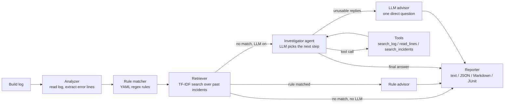

# PipelineDoctor 🩺

**Diagnose failed CI/CD build logs in seconds.** PipelineDoctor reads a failed build log from Jenkins, GitHub Actions or Azure DevOps, finds the real error, explains the likely cause in plain English and suggests how to fix it.

It combines four layers, wired together as an **agent workflow in LangGraph**:

1. **Rule engine** – fast, deterministic regex rules (YAML) for common failures.
2. **Knowledge base retrieval** – finds similar past incidents and how they were fixed (the retrieval part of RAG).
3. **AI investigator agent** – for logs no rule recognises, an LLM investigates on its own: it decides which tool to use next (search the log, read lines around an error, search past incidents), looks at the result, and repeats until it can give a diagnosis. Runs on a **free local model via Ollama** (no API key) or on Claude. Its output is validated and its confidence is capped below rule-based results.
4. **Self-healing runner** – `pipelinedoctor run -- <build command>` runs your build, diagnoses a failure, and **automatically retries transient failures** (network resets, 503s, rate limits) with backoff. Everything else is reported for a human – a model guess never triggers an action.

[](https://github.com/Praneshragavendar/pipeline-doctor/actions/workflows/ci.yml) – the `agent` job runs the investigator on a real local LLM (Ollama, `qwen2.5:7b`) in GitHub Actions and shows each step it took in the job summary.

```
$ pipelinedoctor analyze sample_logs/azure_msvc_toolset.log

======================================================================
[DIAGNOSED] sample_logs/azure_msvc_toolset.log
======================================================================
Category   : Toolchain / Compiler
Severity   : high
Confidence : 90%  (source: rules)
Rule       : MSVC_TOOLSET_MISMATCH

Likely cause:
  The build agent is using a different MSVC / Visual C++ toolset version than the one
  the project was built with, or the toolset path is hardcoded and does not exist on this agent.

How to fix:
  1. Check installed toolsets on the agent: run 'vswhere -all -products *' or look under VC\Tools\MSVC.
  2. Do not hardcode toolset paths. Read them from a pipeline/environment variable (e.g. VC_VARS).
  3. Align the project's PlatformToolset with the version installed on the agent, or install the missing one.

Evidence from the log:
  > [ERROR] Cannot find C:\...\VC\Auxiliary\Build\vcvars64.bat
  > Expected MSVC 14.44.35207, found 14.44.35227 - MSVC toolset version mismatch

Similar past incidents:
  - INC-001 (20% similar): C++ build fails on build agent but works on developer machine
```

## Why I built this

During my internship I built CI/CD pipelines for Siemens Teamcenter deployments on Azure DevOps. Most of my debugging time went into reading long logs to find one line: an MSVC toolset mismatch, a corporate firewall breaking TLS during agent registration, PowerShell 5.1 rejecting `&&`, a deploy script picking up a stale folder. The fixes were usually known – they just lived in someone's head. PipelineDoctor turns that knowledge into rules and a searchable incident history, and uses an LLM only when the pattern is genuinely new.

## Architecture



| Agent (LangGraph node) | Job |
|---|---|
| `analyzer` | Reads the log (handles UTF-8/UTF-16/cp1252, Windows line endings, ANSI colours) and extracts error-looking lines |
| `rule_matcher` | Scores every YAML rule against the log; best match first |
| `retriever` | Finds the most similar past incidents using TF-IDF + cosine similarity (pure Python, no vector DB needed) |
| `rule_advisor` | Builds the diagnosis from the best rule (confidence 80–90%) |
| `investigator` | **The agent.** Sends the LLM what it knows so far; the LLM replies with its next action as JSON (a tool call or a final diagnosis). Max 6 tool calls |
| `tools` | Runs the tool the agent chose – all read-only – and feeds the result back to the investigator (the agent loop) |
| `llm_advisor` | Fallback if the agent's replies are unusable twice: asks the LLM once with error lines + retrieved incidents |
| `reporter` | Produces the final diagnosis (including the agent's step-by-step investigation), or an honest "unknown" with next steps |

Example of the agent's investigation in a report:

```
How the agent investigated:
  1. search_log(pattern='state lock') -> 3 matching line(s): 6: Acquiring state lock. This may take a few moments...
  2. read_lines(start=8, end=17) -> 8: Error: Error acquiring the state lock
  3. search_incidents(query='terraform state lock dynamodb') -> no similar past incidents
  4. final()
```

## Features

- **Agentic AI investigation** of unknown failures (ReAct loop in LangGraph) on a free local LLM via **Ollama**, or Claude via the Anthropic API
- **Self-healing runs**: transient failures are retried automatically with exponential backoff; the command's exit code is passed through so pipelines still fail when they should
- 16 built-in failure patterns: compiler/toolset, TLS certificates, proxy/DNS, transient network errors (retryable), PowerShell syntax, Python/Maven/npm dependencies, Java compile errors, test failures, permissions, disk space, out-of-memory, Docker daemon, Git conflicts, timeouts
- Rules and incidents live in YAML – add a new pattern without touching code
- Output as **text**, **JSON** (for other tools), **JUnit XML** (Jenkins test reports) or **Markdown** (GitHub job summaries)
- **Config linter** (`pipelinedoctor lint`): validates rule and incident YAML (schema, duplicate IDs, invalid or over-broad regex) with a fix hint for every issue; runs as a CI gate in Jenkins and GitHub Actions
- CI-friendly exit codes: `0` diagnosed, `2` unknown (with `--fail-on-unknown`), `3` bad input, `4` lint failed
- **Cross-platform**: Linux, Windows and WSL2; no hardcoded paths (`pathlib` + environment variables); handles UTF-16/cp1252 Windows logs and CRLF line endings; Bash and PowerShell wrapper scripts
- Works fully offline; the LLM is optional
- 78 tests (pytest) including the agent loop with a scripted fake LLM, the self-healing runner, and **stress tests** (100,000-line log, 200 logs in a row, binary garbage input)
- **Jenkinsfile** (lint → test → smoke test, JUnit results) and **GitHub Actions** CI on a Linux/Windows matrix, a Docker image, and an end-to-end agent job on a real local LLM

## Quick start

```bash
git clone https://github.com/Praneshragavendar/pipeline-doctor.git
cd pipeline-doctor
python -m venv .venv
source .venv/bin/activate        # Windows: .venv\Scripts\activate
pip install -e ".[dev]"

pipelinedoctor analyze sample_logs/agent_ssl_registration.log
pipelinedoctor analyze sample_logs/*.log --format json
pipelinedoctor analyze sample_logs/*.log --format junit > diagnoses.xml
pipelinedoctor lint --strict
pipelinedoctor rules
pytest -v
```

### Wrapper scripts (no install needed)

```bash
./scripts/diagnose.sh build.log                              # Linux / macOS / WSL2
PIPELINEDOCTOR_FORMAT=json ./scripts/diagnose.sh build.log
```

```powershell
.\scripts\diagnose.ps1 build.log                              # Windows PowerShell 5.1 / 7
```

### Windows + WSL2

The same checkout works in Windows and inside WSL2. Paths are built with `pathlib`, configuration comes from environment variables, and logs written on Windows (CRLF, UTF-16) are decoded automatically, so a log produced by a Windows build agent can be analysed from WSL2 and vice versa:

```bash
# inside WSL2, analysing a log produced on the Windows side
./scripts/diagnose.sh /mnt/c/agent/_work/1/s/build.log
```

### Turn on the AI investigator (free, local)

Install [Ollama](https://ollama.com), download a small model, and point PipelineDoctor at it:

```bash
ollama pull qwen2.5:3b
export PIPELINEDOCTOR_LLM=ollama              # Windows PowerShell: $env:PIPELINEDOCTOR_LLM="ollama"
pipelinedoctor analyze sample_logs/terraform_state_lock.log
```

Or use Claude instead: `export ANTHROPIC_API_KEY=your-key`. With no LLM at all, unknown logs still get the most similar past fixes and next steps.

### Self-healing runs

```bash
pipelinedoctor run --max-retries 2 -- mvn -B package
pipelinedoctor run --github-summary -- ./gradlew build     # in GitHub Actions: report goes to the job summary
```

If the build fails with a failure matched by a rule marked `retryable: true` (e.g. `Connection reset by peer`, `503 Service Unavailable`, `429 Too Many Requests`), it waits (5 s, then 10 s, ...) and runs the command again. Any other failure is diagnosed and reported with fix hints, without retrying.

### Docker

```bash
docker build -t pipelinedoctor .
docker run --rm -v "$PWD/sample_logs:/logs" pipelinedoctor analyze /logs/docker_disk_full.log
```

## Configuration

| Setting | Flag | Environment variable | Default |
|---|---|---|---|
| Rules file | `--rules` | `PIPELINEDOCTOR_RULES` | bundled `pipelinedoctor/data/rules.yaml` |
| Knowledge base | `--kb` | `PIPELINEDOCTOR_KB` | bundled `pipelinedoctor/data/past_incidents.yaml` |
| LLM provider | – | `PIPELINEDOCTOR_LLM` (`ollama`, `anthropic`, `off`) | `anthropic` if a key is set, otherwise off |
| Ollama model / host | – | `PIPELINEDOCTOR_OLLAMA_MODEL` / `OLLAMA_HOST` | `qwen2.5:3b` / `http://localhost:11434` |
| Anthropic key / model | – | `ANTHROPIC_API_KEY` / `PIPELINEDOCTOR_MODEL` | not set / `claude-haiku-5-5` |
| LLM timeout (seconds) | – | `PIPELINEDOCTOR_LLM_TIMEOUT` | 300 for Ollama, 60 for Anthropic |
| Disable LLM | `--no-llm` | – | off |
| Retries / backoff (`run`) | `--max-retries` / `--backoff` | – | 2 / 5 seconds |

### Adding a rule

```yaml
- id: MY_NEW_FAILURE
  category: Dependencies
  severity: medium
  priority: 60
  retryable: false        # true only for temporary failures that pass on a re-run
  patterns:
    - "some error text from the log"
  cause: Plain-English explanation of why this happens.
  fix_hints:
    - First thing to try.
    - Second thing to try.
```

Rules are validated on load (required fields, valid regex) so a bad rule fails fast with a clear message.

## Use it in your pipeline

- **Jenkins:** see the [`Jenkinsfile`](Jenkinsfile). It lints the rule files (`pipelinedoctor lint --strict`), runs the tests, diagnoses sample logs and publishes JUnit XML results. In your own pipeline, add `pipelinedoctor analyze build.log --format junit > diagnosis.xml` in a `post { failure { ... } }` block and publish it with the `junit` step.
- **GitHub Actions:** see [`examples/github-actions-diagnose-on-failure.yml`](examples/github-actions-diagnose-on-failure.yml). The build runs through `pipelinedoctor run`, so network blips are retried automatically and any other failure is diagnosed in the job summary.

## Project structure

```
pipelinedoctor/
  cli.py            command-line interface and exit codes
  agents.py         LangGraph workflow (analyzer -> matcher -> retriever -> advisor/agent -> reporter)
  investigator.py   the AI agent: prompt, action parsing and read-only tools
  runner.py         self-healing `run` command (retry transient failures with backoff)
  log_reader.py     robust log reading and error-line extraction
  rules_engine.py   YAML rule loading, validation and matching
  knowledge.py      TF-IDF retrieval over past incidents
  llm.py            LLM providers (Ollama, Anthropic), prompts and output validation
  report.py         text / JSON / JUnit XML / Markdown output
  linter.py         YAML config linter (CI gate)
  data/             rules.yaml and past_incidents.yaml
scripts/            diagnose.sh (Linux/WSL2), diagnose.ps1 (Windows), flaky_build.py (self-healing demo)
examples/           how to plug PipelineDoctor into your own GitHub Actions pipeline
sample_logs/        realistic failed logs for demos and tests
tests/              unit, CLI, XML and stress tests
Jenkinsfile         Jenkins pipeline: lint -> test -> smoke test -> JUnit results
```

## Design decisions

- **Rules before AI.** Known failures are answered deterministically, instantly and for free. The LLM is only used for genuinely new patterns, and its confidence is capped at 80% so it never outranks a rule match.
- **Agent tools are read-only; actions are rule-driven.** The investigator can search and read, but cannot change anything. Retrying a build is decided by a `retryable: true` rule, never by a model guess, so a hallucination can't trigger an action.
- **Bounded agent loop.** At most 6 tool calls, then the agent must answer; two unusable replies fall back to a single direct question. Ollama's JSON mode keeps small local models on the expected format.
- **Validate AI output.** The LLM must return JSON; the reply is parsed, type-checked and clipped. A malformed or failed reply degrades to "unknown" instead of crashing the pipeline.
- **No vector database.** With tens of incidents, TF-IDF in plain Python is fast enough and keeps the tool dependency-light. Swapping in embeddings + a vector store (e.g. ChromaDB) is a contained change in `knowledge.py`.
- **Helpful errors.** Every failure message includes a fix hint (missing file, bad YAML, invalid regex).
- **Lint the knowledge, not just the code.** Rules are data, so a typo in a regex can silently break detection. The linter catches it in CI before it is merged.

## Roadmap

- Embedding-based retrieval with ChromaDB for larger incident histories
- Learn new incidents automatically from resolved failures
- Post diagnoses as pull-request comments
- An MCP server so AI assistants can call PipelineDoctor as a tool
- More safe self-healing actions (e.g. clean the workspace and retry on "No space left on device")

## License

MIT
